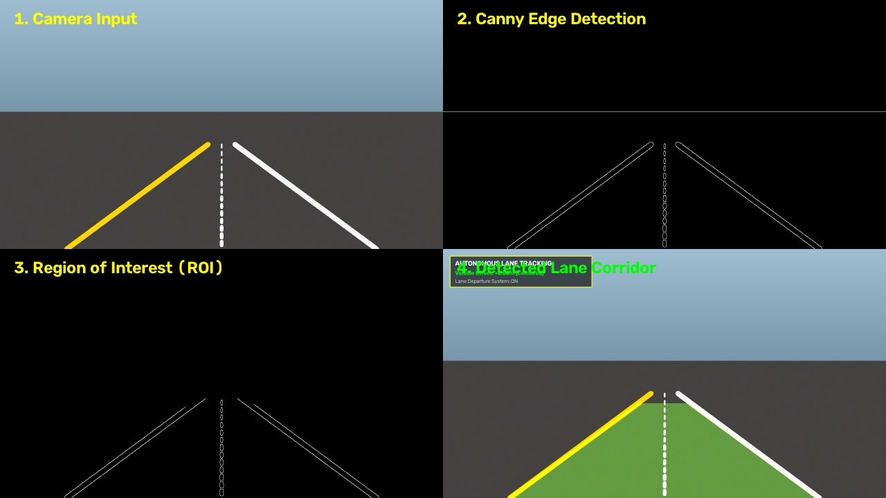
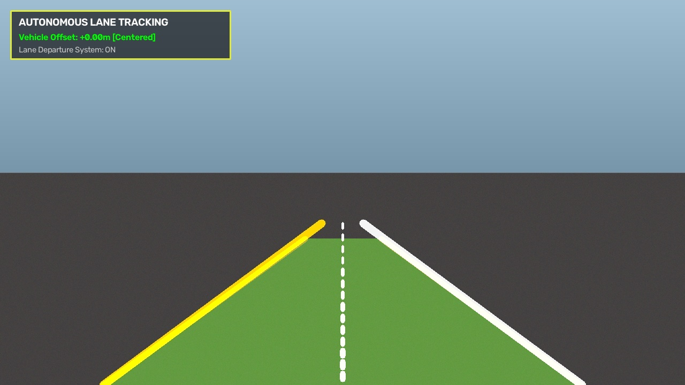

# 🚗 Real-Time Autonomous Road Lane Line Detection & Telemetry System

[](https://www.python.org/)
[](https://opencv.org/)
[](https://numpy.org/)
[](LICENSE)
[](#)
[](#)

A production-grade Computer Vision system developed in Python and OpenCV designed to identify, extrapolate, and track highway lane boundaries in real time from camera feeds and dashcam videos. It computes vehicle lateral lane offset (Lane Departure Warning - LDW) and features a real-time HUD telemetry dashboard simulating Advanced Driver Assistance Systems (ADAS) in autonomous self-driving cars.

---

## 📸 Visual Pipeline & Output Showcase

### 1. Multi-Stage Computer Vision Diagnostic Matrix (2×2 Dashboard)
Shows the complete algorithmic transition from raw input frame to final driveable corridor extrapolation:



### 2. Autonomous Lane Tracking with Telemetry HUD Overlay
Annotated highway view highlighting the driveable green corridor, yellow lane boundaries, and active vehicle departure metrics:



---

## 📑 Table of Contents
1. [🌟 Key Features](#-key-features)
2. [🧠 Algorithmic Pipeline & Mathematics](#-algorithmic-pipeline--mathematics)
3. [📂 Repository Structure](#-repository-structure)
4. [🚀 Quickstart & Installation](#-quickstart--installation)
5. [💻 Command-Line Interface (CLI) Usage](#-command-line-interface-cli-usage)
6. [🧪 Unit Testing & Verification](#-unit-testing--verification)
7. [🎯 Comprehensive Viva & Interview Preparation](#-comprehensive-viva--interview-preparation)
8. [🔮 Future Roadmap](#-future-roadmap)
9. [👤 Author & License](#-author--license)

---

## 🌟 Key Features

- **Grayscale Mapping & Gaussian Smoothing:** Suppresses high-frequency asphalt textures, pebble noise, and compression artifacts using a $5 \times 5$ Gaussian kernel.
- **Canny Edge Detection:** Computes dual-threshold intensity gradients ($50$ to $150$) with non-maximum suppression to extract lane boundaries.
- **Dynamic Trapezoidal Region of Interest (ROI):** Isolates the forward drive path and discards irrelevancies like the sky, roadside structures, and vehicle hood.
- **Probabilistic Hough Line Transform (`HoughLinesP`):** Converts edge pixel points into discrete mathematical line segments.
- **Slope Partitioning & Linear Polynomial Regression:** Classifies lines into Left ($\text{slope} < 0$) and Right ($\text{slope} > 0$), filtering out horizontal noise, and fits a first-degree polynomial ($x = my + c$).
- **Driveable Corridor Highlighting:** Paints a semi-transparent green polygonal corridor (`cv2.fillPoly`) between the left and right lane markers.
- **Vehicle Lateral Offset & Lane Departure Warning (LDW):** Calculates vehicle displacement from the lane center in meters, alerting drivers when drifting.
- **Temporal Video Smoothing:** Exponential Moving Average (EMA) prevents frame-to-frame lane jitter or blinking during momentary occlusions.
- **Real-Time Webcam Support:** Process live feeds directly from connected webcams or video capture cards.
- **Multi-Panel Diagnostic Exporter:** Generates a 4-quadrant diagnostic dashboard for presentations and debugging.

---

## 🧠 Algorithmic Pipeline & Mathematics

```
           [Input Video Frame / Image]
                        │
                        ▼
            1. Grayscale Conversion
               (cv2.COLOR_BGR2GRAY)
                        │
                        ▼
          2. Gaussian Blur Noise Filter
               (5x5 Gaussian Kernel)
                        │
                        ▼
             3. Canny Edge Detection
             (G = √(Gx² + Gy²), 50-150)
                        │
                        ▼
           4. Trapezoidal ROI Masking
           (Discards Sky, Hood, Scenery)
                        │
                        ▼
         5. Probabilistic Hough Transform
           (r = x·cos(θ) + y·sin(θ))
                        │
                        ▼
          6. Slope Filtering & Polyfit
           (Left: slope < 0 | Right: slope > 0)
                        │
                        ▼
         7. Temporal Exponential Smoothing
          (L_t = α·L_curr + (1-α)·L_prev)
                        │
                        ▼
         8. Vehicle Center Offset & HUD
         (offset = (x_car - x_lane) * 3.7 / width)
                        │
                        ▼
       [Final Driveable Path & Telemetry HUD]
```

### Mathematical Foundations

1. **Gaussian Smoothing:**
   Convolves image pixels with a 2D Gaussian distribution:
   $$G(x, y) = \frac{1}{2\pi\sigma^2} \exp\left(-\frac{x^2 + y^2}{2\sigma^2}\right)$$

2. **Canny Gradient Computation:**
   Gradients are calculated along $x$ and $y$ axes using Sobel operators:
   $$|G| = \sqrt{G_x^2 + G_y^2}, \quad \theta = \arctan\left(\frac{G_y}{G_x}\right)$$

3. **Hough Line Equation in Polar Space:**
   Maps collinear Cartesian points $(x, y)$ into sinusoidal curves in $(\rho, \theta)$ space:
   $$\rho = x \cos\theta + y \sin\theta$$

4. **Vehicle Lateral Offset Calculation:**
   Assuming a camera centered on the windshield and a standard lane width of $3.7\text{ meters}$:
   $$\text{Lane Center} = \frac{x_{\text{left\_bottom}} + x_{\text{right\_bottom}}}{2}$$
   $$\text{Vehicle Offset (m)} = \left(\frac{\text{Image Center} - \text{Lane Center}}{x_{\text{right\_bottom}} - x_{\text{left\_bottom}}}\right) \times 3.7\text{ m}$$

---

## 📂 Repository Structure

```text
road-lane-detection/
├── data/
│   ├── test_images/                # Sample input road imagery
│   │   └── sample_road.jpg
│   └── test_videos/                # Sample highway dashcam recordings
│       └── sample_highway.mp4
├── output/                         # Processed visual outputs and dashboards
│   ├── dashboard_sample_road.jpg   # 4-stage pipeline diagnostic matrix
│   ├── detected_sample_road.jpg    # Final annotated image with HUD
│   └── detected_sample_highway.mp4 # Processed video output
├── src/
│   ├── __init__.py                 # Package exports
│   ├── lane_detector.py            # Core LaneDetector class and computer vision pipeline
│   └── utils.py                    # Multi-panel visualizer and procedural road generator
├── tests/
│   ├── __init__.py
│   └── test_lane_detector.py       # Unit test suite covering all CV stages
├── .gitignore                      # Git exclusion rules
├── LICENSE                         # MIT Open Source License
├── main.py                         # CLI execution runner
├── requirements.txt                # Package dependencies
└── README.md                       # Documentation & viva study guide
```

---

## 🚀 Quickstart & Installation

### Step 1: Clone Repository
```bash
git clone https://github.com/kdev76979-mac/road-lane-detection.git
cd road-lane-detection
```

### Step 2: Set up Virtual Environment
```bash
# macOS / Linux
python3 -m venv venv
source venv/bin/activate

# Windows
python -m venv venv
venv\Scripts\activate
```

### Step 3: Install Dependencies
```bash
pip install -r requirements.txt
```

### Step 4: Run the Complete Demo
Generates built-in highway data, processes both image and video feeds, and exports the 4-stage dashboard:
```bash
python main.py
```
Outputs will be saved directly into the `output/` directory!

---

## 💻 Command-Line Interface (CLI) Usage

| Option | Flag | Description |
|---|---|---|
| **Quick Demo** | `python main.py` | Runs the end-to-end pipeline on built-in sample data |
| **Custom Image** | `python main.py --image path/to/image.jpg` | Detects lanes on any custom road picture |
| **Custom Video** | `python main.py --video path/to/video.mp4` | Processes a dashcam video with temporal smoothing |
| **Live Webcam** | `python main.py --webcam 0` | Starts real-time processing from connected camera |
| **Disable HUD** | `python main.py --image ... --no-hud` | Renders clean lanes without telemetry badge |
| **Custom Output**| `python main.py --image ... --output output/result.jpg` | Specifies a custom output path |
| **Make Samples** | `python main.py --generate-samples` | Regenerates sample test images and videos |

---

## 🧪 Unit Testing & Verification

The project includes unit tests verifying each stage of the computer vision pipeline:

```bash
python -m unittest discover tests
```

Expected output:
```text
..........
----------------------------------------------------------------------
Ran 10 tests in 0.186s

OK
```

---

## 🎯 Comprehensive Viva & Interview Preparation

### 1. Why convert the image to Grayscale?
**Answer:** Grayscale reduces 3-channel color data (RGB/BGR) to a single channel of intensity values, reducing computational overhead by $\sim 66\%$. Edge detection algorithms (such as Canny) rely exclusively on intensity gradients, making chrominance information redundant.

### 2. Why is Gaussian Blur necessary before Canny edge detection?
**Answer:** The derivative operations in edge detection are sensitive to high-frequency noise (e.g., asphalt aggregate, shadows, sun glare). A Gaussian filter acts as a low-pass filter to smooth out pixel-level fluctuations, ensuring that only true structural edges are detected.

### 3. Why is the Left Lane slope negative in OpenCV coordinates?
**Answer:** In OpenCV, the coordinate origin $(0, 0)$ is situated at the **top-left corner**. The vertical axis $y$ increases downwards. A lane marking traveling from bottom-left to center-horizon moves in the direction of increasing $x$ but decreasing $y$. Therefore, $\Delta y < 0$ while $\Delta x > 0$, producing a negative slope $\frac{\Delta y}{\Delta x} < 0$.

### 4. What is the difference between standard and Probabilistic Hough Transform (`HoughLinesP`)?
**Answer:** The standard Hough Transform votes in an accumulator array across all edge points and returns infinite mathematical lines $(\rho, \theta)$. `HoughLinesP` is an optimization that samples a subset of edge points and returns explicit finite line segments $[x_1, y_1, x_2, y_2]$ with a defined minimum length (`minLineLength`) and maximum allowed gap (`maxLineGap`), making it faster and practical for line extrapolation.

### 5. Why fit $x = my + c$ instead of $y = mx + b$?
**Answer:** Highway lane lines in perspective projection are nearly vertical. As lines approach verticality, their slope in $y = mx + b$ approaches infinity ($\infty$), which can cause numerical instability and overflow in linear regression. By expressing $x$ as a function of $y$ ($x = f(y)$), the slope remains well-conditioned because $y$ changes monotonically from the bottom of the screen to the horizon.

### 6. How does Temporal Smoothing (Exponential Moving Average) work?
**Answer:** In video streams, road occlusions, cracked pavement, or glare can cause detected lane parameters to jump abruptly or disappear for single frames. EMA smooths parameters using:
$$L_t = \alpha \cdot L_{\text{curr}} + (1 - \alpha) \cdot L_{t-1}$$
where $\alpha \in [0, 1]$ controls the weight between current detection and historical memory, producing stable, flicker-free tracking.

### 7. How is Region of Interest (ROI) masking achieved?
**Answer:** An image mask of the same dimensions is initialized with zeros. A trapezoidal polygon representing the driver's forward corridor is filled with $255$ using `cv2.fillPoly`. A bitwise AND operation (`cv2.bitwise_and`) between the Canny edge map and the mask discards all edges outside this polygon (such as sky, horizon, hood, and adjacent roadside elements).

### 8. How is the Vehicle Center Offset calculated?
**Answer:** We assume the camera is mounted along the vehicle's center axis. The midpoint of the bottom-most left and right lane intercepts represents the lane center. The distance between the image midpoint and this lane center (in pixels) is scaled to real-world meters using the standard highway lane width ($3.7\text{ meters}$).

---

## 🔮 Future Roadmap

- [ ] **Curved Lane Tracking:** Implementation of 2nd-degree polynomial fitting ($x = ay^2 + by + c$) with Perspective Warp (Bird's Eye View / Inverse Perspective Mapping).
- [ ] **Deep Learning Integration:** Hybrid ensemble with LaneNet or Ultra-Fast-Lane-Detection for adverse weather and night conditions.
- [ ] **Object & Obstacle Detection:** Real-time YOLOv8 integration for joint lane tracking and vehicle/pedestrian bounding boxes.
- [ ] **Edge Hardware Deployment:** Optimization for Raspberry Pi 5 / NVIDIA Jetson Nano using TensorRT.

---

## 👤 Author & License

- **Developer:** Dev Kushwah ([@kdev76979-mac](https://github.com/kdev76979-mac))
- **License:** Distributed under the [MIT License](LICENSE). Free for academic, personal, and commercial use.
